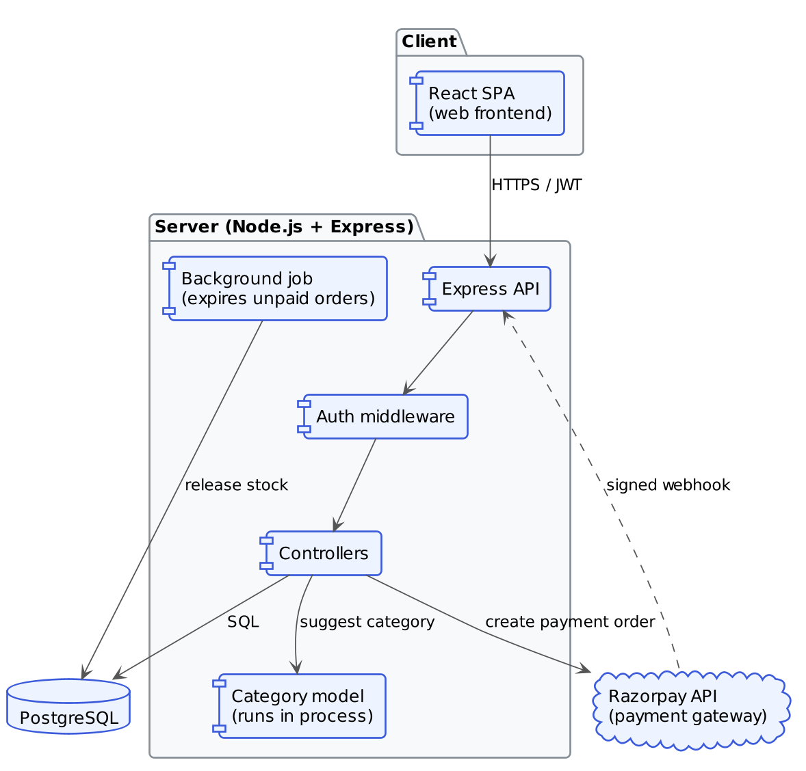
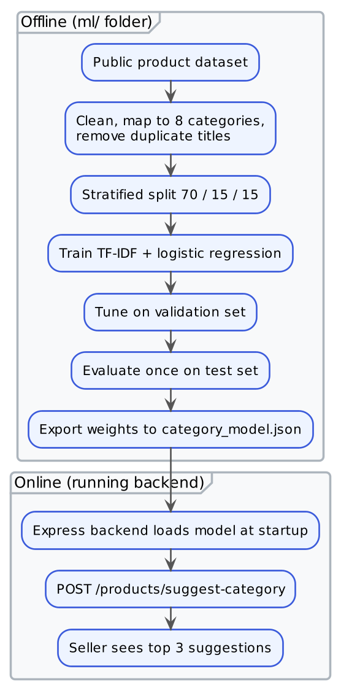

# 13. Architecture Diagram

## 13.1 System Architecture

ShopSphere is a monolithic backend that serves a REST API to a separate single-page React frontend. The reasoning for choosing a monolith is recorded in ADR-001 (section 13.3).

| Component | Responsibility |
|---|---|
| **React SPA** | The user interface for all roles; talks to the backend over HTTPS using a JWT |
| **Express API** | Receives requests and returns JSON responses |
| **Auth middleware** | Verifies the token and checks the user's role before any controller runs |
| **Controllers** | Business logic for each module (auth, sellers, products, cart, orders, payments, reports) |
| **PostgreSQL** | Stores all persistent data; provides the transactions that protect stock |
| **Razorpay API** | External payment gateway; sends a signed webhook when a payment succeeds or fails |
| **Category model** | Suggests product categories; runs inside the API process (ADR-005), not as a separate service |
| **Background job** | Periodically expires unpaid orders and returns their stock (ADR-003) |

## 13.2 Machine Learning Pipeline

The full path from raw data to a suggestion shown to a seller. Everything up to the export step happens offline in the `ml/` folder; everything after it is part of the running backend. Each step is explained in section 10.10 ([`10-MODULES-OF-THE-SYSTEM.md`](10-MODULES-OF-THE-SYSTEM.md)).

## 13.3 Key Design Decisions

Each decision is recorded with what was decided, why, and the trade-off that was accepted.

### ADR-001: Monolith over microservices
**Decision:** Single Express application, not split into separate services (e.g. auth-service, order-service, product-service).
**Why:** At this scale (three roles, seven database tables), microservices would add deployment and inter-service communication overhead without a corresponding benefit — there's no independent team ownership or scaling need per domain. A modular folder structure (`routes/`, `controllers/`, `models/` per domain) keeps the codebase organised without paying the operational cost of distributed systems.
**Trade-off accepted:** If seller-side traffic ever needed to scale independently of customer-side browsing traffic, this would require refactoring later. Acceptable for the project's scope.

### ADR-002: Multi-seller orders as a single Order with per-seller sub-orders
**Decision:** A customer's checkout across multiple sellers creates one `orders` row (representing the checkout transaction) with multiple `order_items` rows, each referencing the seller via the product. Sellers query their own items via a join rather than the system creating separate order records per seller.
**Why:** Keeps a single payment transaction and a single order confirmation from the customer's point of view, matching real checkout UX, while still letting each seller see only their own items.
**Trade-off accepted:** Per-seller order status (e.g. one seller ships, another delays) has to be tracked at the `order_items` level rather than the `orders` level — see section 15.3.6 ([15-DATABASE-DESIGN.md](15-DATABASE-DESIGN.md)).

### ADR-003: Stock decrement at order placement, not at payment confirmation
**Decision:** Product stock is decremented when the order is placed (cart → order), before payment confirmation, with a background job to release stock if payment isn't confirmed within 15 minutes.
**Why:** Prevents two customers from simultaneously "winning" the last unit of a product while payment is pending. Considered decrementing only after payment webhook confirmation, but that allows overselling during the payment window.
**Trade-off accepted:** Requires a cleanup job (`releaseExpiredOrders`) and adds a bit of complexity around order status transitions (`pending_payment → confirmed` / `pending_payment → expired`).

### ADR-004: JWT access + refresh tokens over session cookies
**Decision:** Stateless JWT pair instead of server-side sessions.
**Why:** See the technology justification in section 8.1 ([08-TOOLS-AND-TECHNOLOGY.md](08-TOOLS-AND-TECHNOLOGY.md)). Also avoids needing a session store (Redis) for a project of this size.
**Trade-off accepted:** Token revocation (e.g. force logout on password change) is harder than with server-side sessions; mitigated with a short (15 min) access token lifetime.

### ADR-005: Category-suggestion model runs inside the Express API, not as a separate ML service
**Decision:** The trained classifier is exported to a JSON file (vocabulary, IDF values, weights) and evaluated in plain TypeScript inside the existing backend process.
**Why:** The model is a TF-IDF + logistic regression classifier, which reduces to a table of weights, so running it in-process is straightforward and takes a few milliseconds. It avoids a second deployable service, a Python runtime in production, and a network hop on every listing. This is consistent with ADR-001 (keep operational complexity low for a project of this size). See section 10.10.3 ([10-MODULES-OF-THE-SYSTEM.md](10-MODULES-OF-THE-SYSTEM.md)) for how the model was chosen.
**Trade-off accepted:** Training happens in Python but inference runs in TypeScript, so the two tokenizers could drift apart; this is guarded by a parity test (see section 18.3.2, [18-CONCLUSION-AND-FUTURE-SCOPE.md](18-CONCLUSION-AND-FUTURE-SCOPE.md)). Swapping in a heavier model later (e.g. a transformer) would force a separate ML service.
