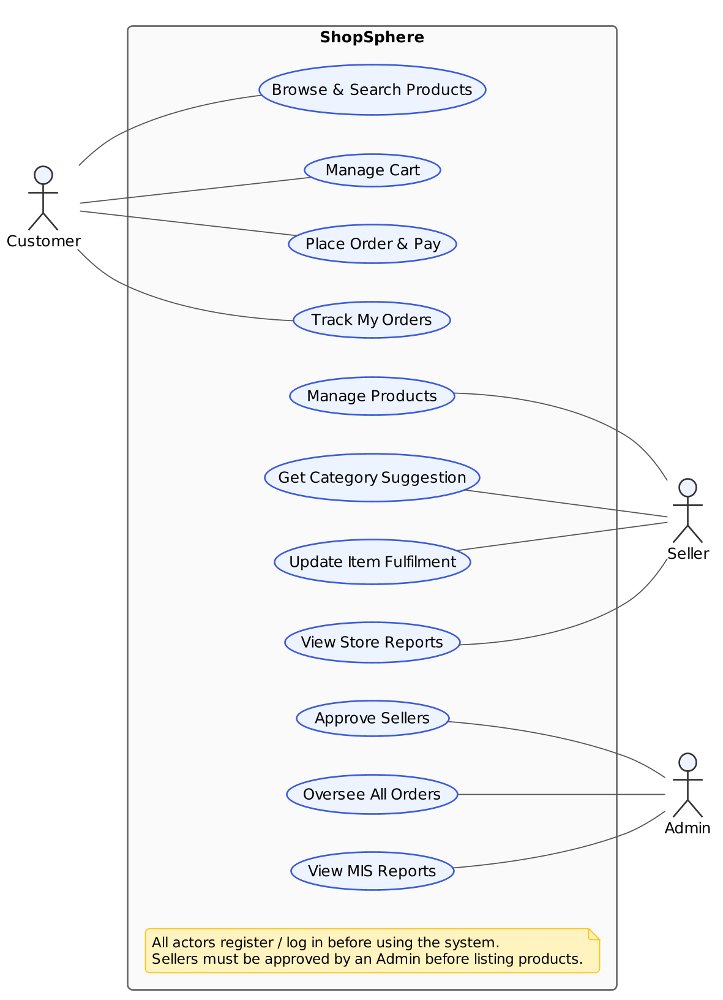
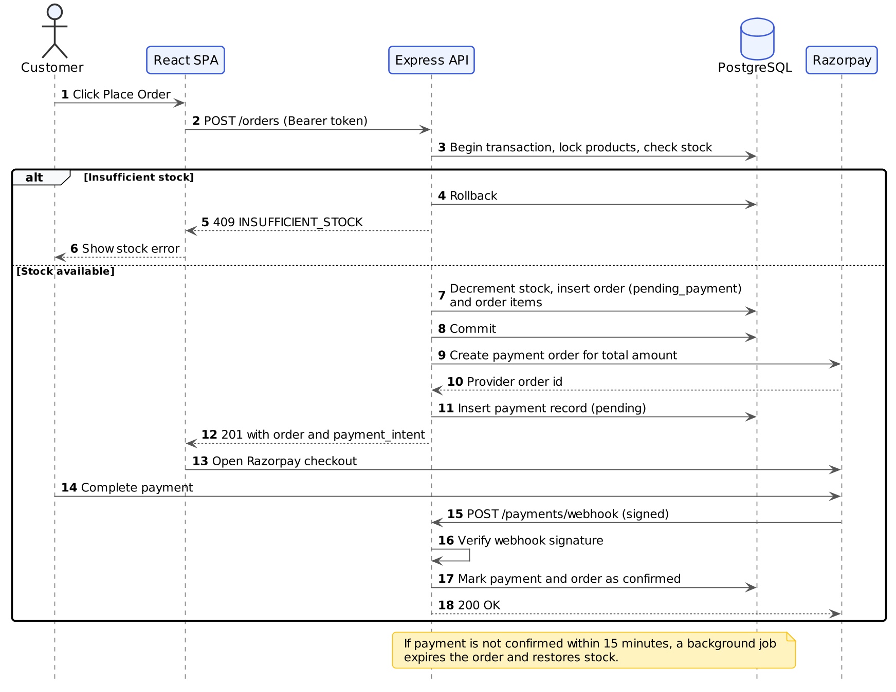
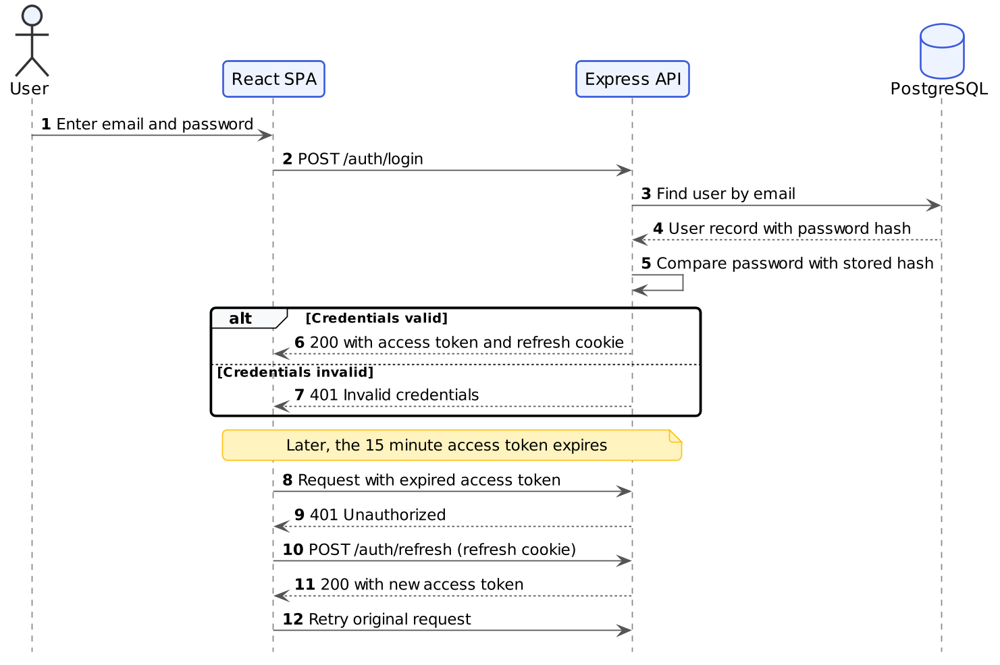
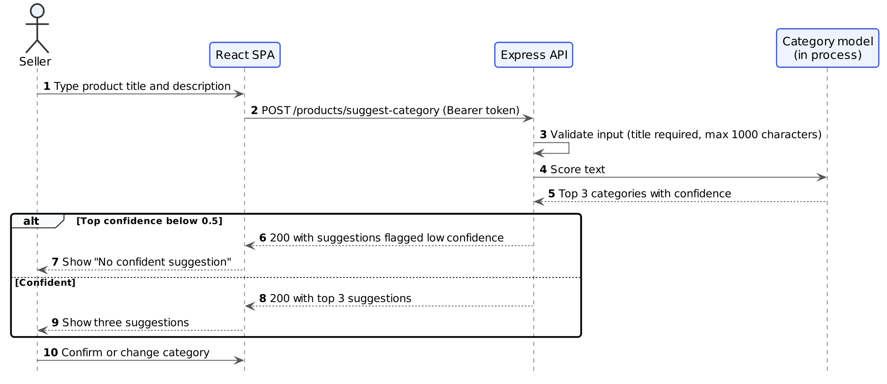
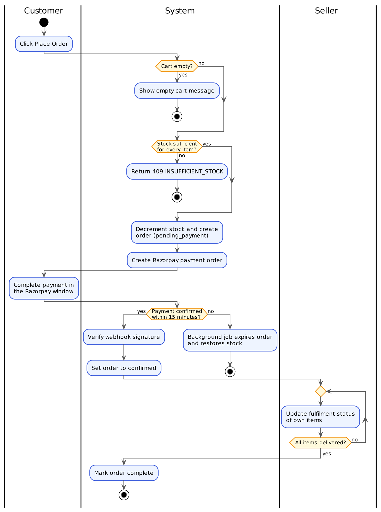

# 14. UML Diagrams

This section contains the class, use case, sequence, and activity diagrams. The architecture diagram is in section 13 and the entity-relationship diagram is in section 15.

## 14.1 Class Diagram

**Not applicable for this project.** The backend is organised as functional modules (routes, controllers, and models as plain functions and query helpers) rather than an object-oriented class hierarchy, so a class diagram would add little beyond what the entity-relationship diagram in section 15 already shows. Projects built around real classes and inheritance or composition (for example a Java/Spring or C# backend with a domain model) are expected to include a class diagram here covering the core domain classes only, not every helper or utility class.

## 14.2 Use Case Diagram

The diagram shows the three actors (Customer, Seller, and Admin) and the major things each can do. Registration and login apply to every actor and are noted on the diagram instead of being drawn as a use case, to keep it readable.

| ID | Use case | Actor | Description |
|---|---|---|---|
| UC1 | Browse and search products | Customer (also Guest) | View the catalogue, filter by category, and search by keyword |
| UC2 | Manage cart | Customer | Add, change, and remove items from different sellers |
| UC3 | Place order and pay | Customer | Check out the cart and pay through the gateway |
| UC4 | Track my orders | Customer | See the status of each item in every order |
| UC5 | Manage products | Seller | Create, edit, and delete own products |
| UC6 | Get category suggestion | Seller | Receive three suggested categories while creating a listing |
| UC7 | Update item fulfilment | Seller | Mark own items as shipped or delivered |
| UC8 | View store reports | Seller | View sales and inventory of own store |
| UC9 | Approve sellers | Admin | Approve or reject pending sellers |
| UC10 | Oversee all orders | Admin | View orders across the whole platform |
| UC11 | View MIS reports | Admin | Generate the management reports in section 17 |

## 14.3 Sequence Diagrams

### 14.3.1 Placing an order and confirming payment

This is the most critical flow in the system because it touches stock, money, and an external service. Stock is reserved when the order is placed, not when payment is confirmed (ADR-003 in section 13.3). The payment status is only updated from the signature-verified webhook, never from the browser (section 11.5). The endpoints match `POST /orders` and `POST /payments/webhook` in section 10.7 and 10.8.

### 14.3.2 Login and token refresh

Shows why the application uses a short-lived access token with a refresh token (ADR-004 in section 13.3): the browser can silently recover from an expired token without forcing the user to log in again. The endpoints match section 10.3.

### 14.3.3 Suggesting a category for a new product

Shows one prediction request from start to finish. The model is loaded once when the server starts and runs inside the API process, so there is no network call to a separate service (ADR-005 in section 13.3). The seller always makes the final choice. The endpoint matches section 10.10.

## 14.4 Activity Diagram

This diagram shows the full life of an order as a business workflow, including the decision points where it can fail or expire. The sequence diagrams above show *who talks to whom*; this one shows *what decisions the process makes*. The loop at the end reflects that every seller updates only their own items until all items are delivered (ADR-002 in section 13.3 and the `fulfillment_status` column in section 15.3.6).
