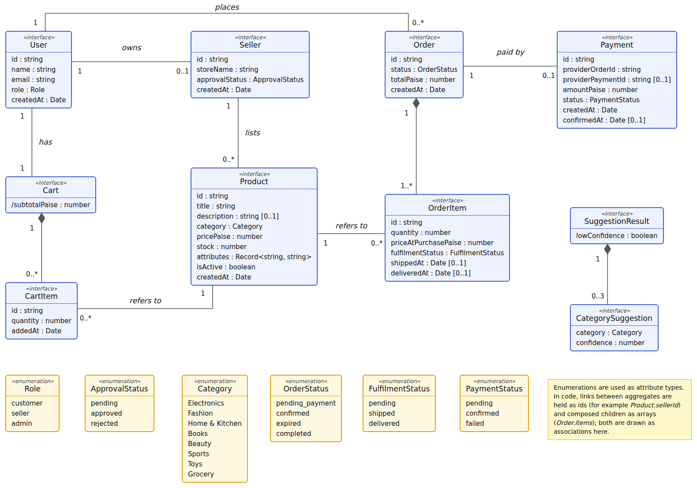

# 14. UML Diagrams

This section contains the class, use case, sequence, and activity diagrams. The architecture diagram is in section 13 and the entity-relationship diagram is in section 15.

## 14.1 Class Diagram

ShopSphere is not built around classes with inheritance; the backend is organised as functional modules (section 13.3, ADR-001). The class diagram therefore shows the **core domain types**: the TypeScript interfaces and enums in `backend/src/models/types.ts` that every module passes around. Operations are not shown because these types carry data only; the functions that act on them belong to the modules in section 10.

The diagram describes the same data as the entity-relationship diagram in section 15.2, but from the application's point of view rather than the database's:

| Entity-relationship diagram (section 15.2) | Class diagram (this section) |
|---|---|
| Tables, columns, and SQL types | Interfaces with TypeScript types (`string`, `number`, `boolean`, `Date`) |
| Foreign key columns such as `order_id` | Associations with multiplicities |
| Status columns stored as `VARCHAR` with a CHECK constraint | Enumerations (`Role`, `OrderStatus`, `FulfilmentStatus`, and so on) |
| `order_items` is a table like any other | Composition: an `Order` owns one or more `OrderItem`s, which cannot exist without it |
| `users.password_hash` column | Not part of `User`; the hash never leaves the authentication code (section 11.5.1) |
| No equivalent | `Cart` (assembled from `cart_items` rows, with a derived subtotal) and `SuggestionResult` / `CategorySuggestion` (produced by the model for each request, section 10.10, and never stored) |

Field names are camelCase in the code and snake_case in the database and API (sections 15.3 and 10); the data-access layer maps between the two.

## 14.2 Use Case Diagram

The diagram shows the three actors (Customer, Seller, and Admin) and the major things each can do. Registration and login apply to every actor and are noted on the diagram instead of being drawn as a use case, to keep it readable. A guest (a visitor who is not logged in, section 12.1) can only perform UC1, so guests are not drawn as a separate actor.

| ID | Use case | Actor | Description |
|---|---|---|---|
| UC1 | Browse and search products | Customer (also Guest) | View the catalogue, filter by category, and search by keyword |
| UC2 | Manage cart | Customer | Add, change, and remove items from different sellers |
| UC3 | Place order and pay | Customer | Check out the cart and pay through the gateway |
| UC4 | Track my orders | Customer | See the status of each item in every order |
| UC5 | Manage products | Seller | Create, edit, and delete own products |
| UC6 | Get category suggestion | Seller | Receive three suggested categories while creating a listing |
| UC7 | Update item fulfilment | Seller | Mark own items as shipped or delivered |
| UC8 | View store reports | Seller | View sales and inventory of own store |
| UC9 | Approve sellers | Admin | Approve or reject pending sellers |
| UC10 | Oversee all orders | Admin | View orders across the whole platform |
| UC11 | View MIS reports | Admin | Generate the management reports in section 17 |

## 14.3 Sequence Diagrams

### 14.3.1 Placing an order and confirming payment

This is the most critical flow in the system because it touches stock, money, and an external service. Stock is reserved when the order is placed, not when payment is confirmed (ADR-003 in section 13.3). The payment status is only updated from the signature-verified webhook, never from the browser (section 11.5). The endpoints match `POST /orders` and `POST /payments/webhook` in section 10.7 and 10.8.

### 14.3.2 Login and token refresh

Shows why the application uses a short-lived access token with a refresh token (ADR-004 in section 13.3): the browser can silently recover from an expired token without forcing the user to log in again. The endpoints match section 10.3.

### 14.3.3 Suggesting a category for a new product

Shows one prediction request from start to finish. The model is loaded once when the server starts and runs inside the API process, so there is no network call to a separate service (ADR-005 in section 13.3). The seller always makes the final choice. The endpoint matches section 10.10.

## 14.4 Activity Diagram

This diagram shows the full life of an order as a business workflow, including the decision points where it can fail or expire. The sequence diagrams above show *who talks to whom*; this one shows *what decisions the process makes*. The loop at the end reflects that every seller updates only their own items until all items are delivered (ADR-002 in section 13.3 and the `fulfilment_status` column in section 15.3.6).
