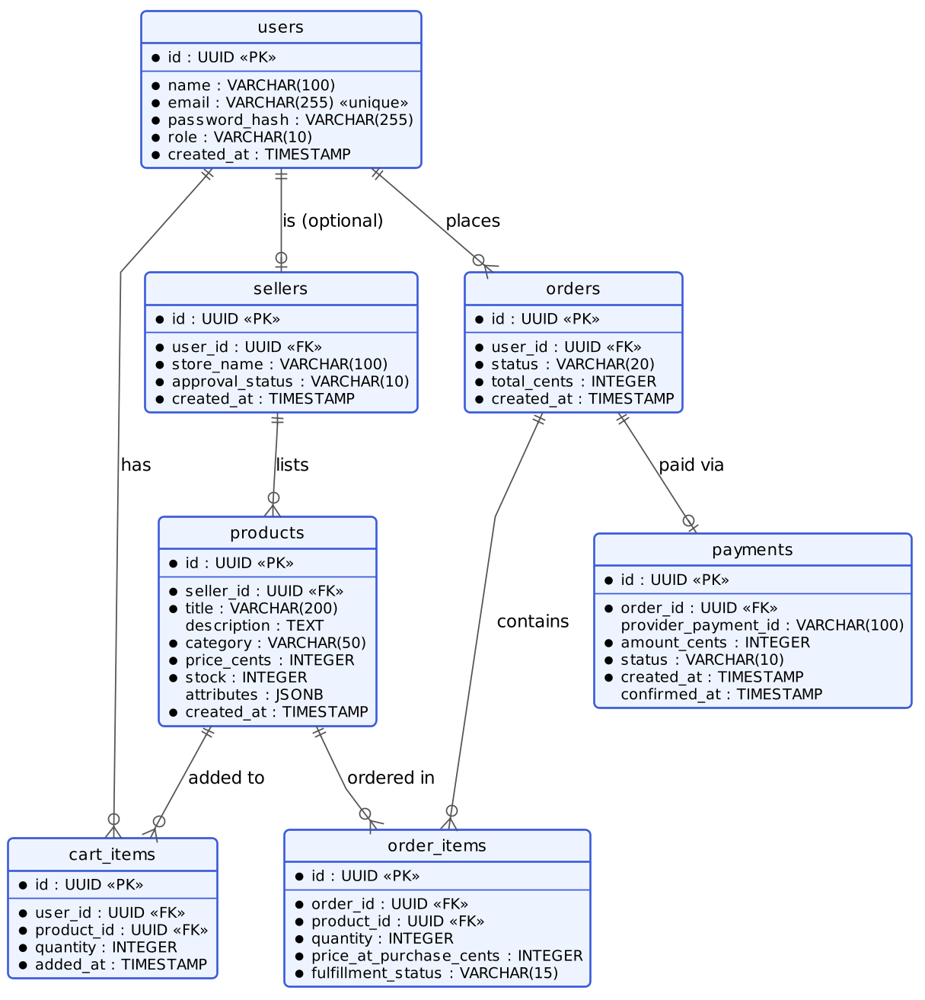

# 15. Database Design

## 15.1 Choice of Database

PostgreSQL was chosen over a NoSQL store because the core entities — users, sellers, products, orders, order items — have well-defined relationships and the system depends on transactional integrity (e.g. an order placement must atomically create the order, order items, and decrement stock, or roll back entirely). A relational database with proper foreign keys and transactions is a better fit than a document store here.

The one place schema flexibility was needed — product attributes vary by category (a T-shirt has "size" and "color"; a laptop has "RAM" and "storage") — is handled with a `JSONB` column on `products` rather than a separate document database, avoiding a two-database architecture for a single flexible field.

## 15.2 Entity-Relationship Diagram

The diagram shows the seven tables of the system and how they relate. A user can optionally also be a seller, which is why `sellers` hangs off `users` instead of being a separate kind of login.

## 15.3 Data Dictionary

All identifiers are UUIDs. Money is stored as integers in paise (hundredths of a rupee). Timestamps are stored without time zone and are assumed to be in UTC.

### 15.3.1 `users`

All registered accounts (customers, sellers, and administrators).

| Column | Type | Constraints | Description |
|---|---|---|---|
| `id` | UUID | Primary key | Unique identifier of the user |
| `name` | VARCHAR(100) | NOT NULL | Full name |
| `email` | VARCHAR(255) | NOT NULL, UNIQUE | Login email address |
| `password_hash` | VARCHAR(255) | NOT NULL | bcrypt hash of the password; the plain password is never stored |
| `role` | VARCHAR(10) | NOT NULL, CHECK in (`customer`, `seller`, `admin`), default `customer` | Role that controls what the user can access |
| `created_at` | TIMESTAMP | NOT NULL, default current time | When the account was created |

### 15.3.2 `sellers`

Store details for users who sell on the platform.

| Column | Type | Constraints | Description |
|---|---|---|---|
| `id` | UUID | Primary key | Unique identifier of the seller |
| `user_id` | UUID | NOT NULL, UNIQUE, foreign key to `users.id` | The user account that owns the store |
| `store_name` | VARCHAR(100) | NOT NULL | Public name of the store |
| `approval_status` | VARCHAR(10) | NOT NULL, CHECK in (`pending`, `approved`, `rejected`), default `pending` | Administrator decision; only approved sellers can list products |
| `created_at` | TIMESTAMP | NOT NULL, default current time | When the seller registered |

### 15.3.3 `products`

Items listed for sale by sellers.

| Column | Type | Constraints | Description |
|---|---|---|---|
| `id` | UUID | Primary key | Unique identifier of the product |
| `seller_id` | UUID | NOT NULL, foreign key to `sellers.id` | The seller who lists the product |
| `title` | VARCHAR(200) | NOT NULL | Product title |
| `description` | TEXT |  | Product description |
| `category` | VARCHAR(50) | NOT NULL | One of the 8 platform categories |
| `price_cents` | INTEGER | NOT NULL, CHECK 0 or more | Price in paise (hundredths of a rupee), stored as an integer to avoid rounding errors |
| `stock` | INTEGER | NOT NULL, CHECK 0 or more | Units currently available |
| `attributes` | JSONB | default empty object | Category-specific details such as size or colour |
| `created_at` | TIMESTAMP | NOT NULL, default current time | When the product was listed |

### 15.3.4 `cart_items`

Products a customer has added to their cart but not yet ordered.

| Column | Type | Constraints | Description |
|---|---|---|---|
| `id` | UUID | Primary key | Unique identifier of the cart line |
| `user_id` | UUID | NOT NULL, foreign key to `users.id` | The customer who owns the cart |
| `product_id` | UUID | NOT NULL, foreign key to `products.id` | The product added |
| `quantity` | INTEGER | NOT NULL, CHECK greater than 0 | Number of units |
| `added_at` | TIMESTAMP | NOT NULL, default current time | When the item was added |
|  |  | UNIQUE (`user_id`, `product_id`) | A product appears once per cart; quantity is updated instead of adding a duplicate |

### 15.3.5 `orders`

One row per checkout. It may contain items from several sellers.

| Column | Type | Constraints | Description |
|---|---|---|---|
| `id` | UUID | Primary key | Unique identifier of the order |
| `user_id` | UUID | NOT NULL, foreign key to `users.id` | The customer who placed the order |
| `status` | VARCHAR(20) | NOT NULL, CHECK in (`pending_payment`, `confirmed`, `expired`, `completed`), default `pending_payment` | Overall state of the order |
| `total_cents` | INTEGER | NOT NULL | Total amount in paise |
| `created_at` | TIMESTAMP | NOT NULL, default current time | When the order was placed |

### 15.3.6 `order_items`

The individual products inside an order. Fulfilment is tracked here because each item belongs to one seller.

| Column | Type | Constraints | Description |
|---|---|---|---|
| `id` | UUID | Primary key | Unique identifier of the order line |
| `order_id` | UUID | NOT NULL, foreign key to `orders.id` | The order this item belongs to |
| `product_id` | UUID | NOT NULL, foreign key to `products.id` | The product ordered |
| `quantity` | INTEGER | NOT NULL, CHECK greater than 0 | Number of units ordered |
| `price_at_purchase_cents` | INTEGER | NOT NULL | Unit price at the time of purchase, so later price changes do not affect past orders |
| `fulfillment_status` | VARCHAR(15) | NOT NULL, CHECK in (`pending`, `shipped`, `delivered`), default `pending` | Fulfilment state, updated by the seller |

### 15.3.7 `payments`

The payment attempt for an order, as reported by the payment gateway.

| Column | Type | Constraints | Description |
|---|---|---|---|
| `id` | UUID | Primary key | Unique identifier of the payment record |
| `order_id` | UUID | NOT NULL, UNIQUE, foreign key to `orders.id` | The order being paid for |
| `provider_payment_id` | VARCHAR(100) |  | The gateway's own payment identifier |
| `amount_cents` | INTEGER | NOT NULL | Amount requested from the gateway, in paise |
| `status` | VARCHAR(10) | NOT NULL, CHECK in (`pending`, `confirmed`, `failed`), default `pending` | Payment state, updated only from the verified webhook |
| `created_at` | TIMESTAMP | NOT NULL, default current time | When the payment record was created |
| `confirmed_at` | TIMESTAMP |  | When the gateway confirmed the payment |

## 15.4 Relationships and Constraints

| Parent table | Child table | Relationship | Foreign key | Meaning |
|---|---|---|---|---|
| `users` | `sellers` | One to zero-or-one | `sellers.user_id` | A user may own one store |
| `users` | `orders` | One to many | `orders.user_id` | A customer places many orders |
| `users` | `cart_items` | One to many | `cart_items.user_id` | A customer's cart holds many lines |
| `sellers` | `products` | One to many | `products.seller_id` | A seller lists many products |
| `products` | `cart_items` | One to many | `cart_items.product_id` | A product can be in many carts |
| `products` | `order_items` | One to many | `order_items.product_id` | A product can be ordered many times |
| `orders` | `order_items` | One to many | `order_items.order_id` | An order contains many items |
| `orders` | `payments` | One to zero-or-one | `payments.order_id` | An order has at most one payment record |

## 15.5 Indexes

| Index | Purpose |
|---|---|
| `users(email)` UNIQUE | Fast login lookup and no duplicate accounts |
| `products(category)` | Category filter on the product listing |
| `products(seller_id)` | A seller's own product list |
| `orders(user_id, created_at)` | A customer's order history |
| `orders(status, created_at)` | The background job that finds expired unpaid orders |
| `order_items(order_id)` | Loading the items of an order |

## 15.6 Notes on Key Design Choices

- **`price_at_purchase_cents` on `order_items`, not just a reference to `products.price_cents`** — prices change over time; an order must reflect what the customer actually paid, not the product's current price.
- **`fulfillment_status` on `order_items` rather than `orders`** — since one order can span multiple sellers (see ADR-002 in section 13.3, [13-ARCHITECTURE-DIAGRAM.md](13-ARCHITECTURE-DIAGRAM.md)), each seller updates only their own items' status.
- **`attributes` as `JSONB` on `products`** — avoids an EAV (entity-attribute-value) table structure, which would complicate every product query with extra joins for a feature that's read far more often than it's queried/filtered on.
- **Money stored as integer cents (`price_cents`), not decimal/float** — avoids floating-point rounding issues in financial calculations.
