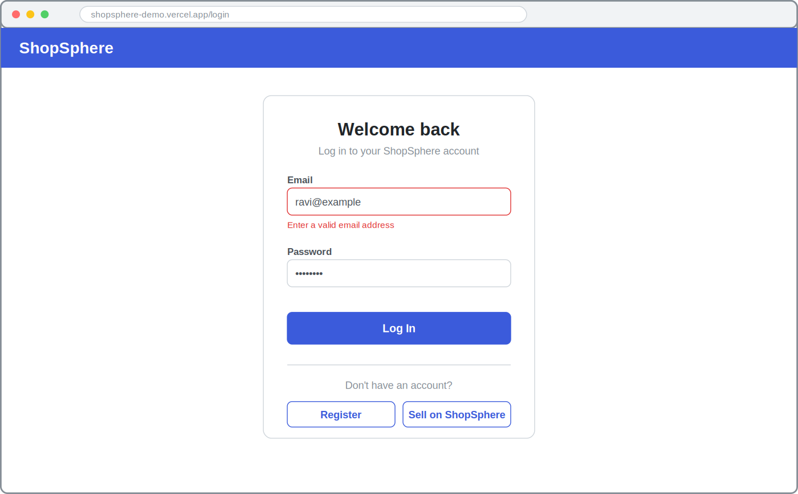
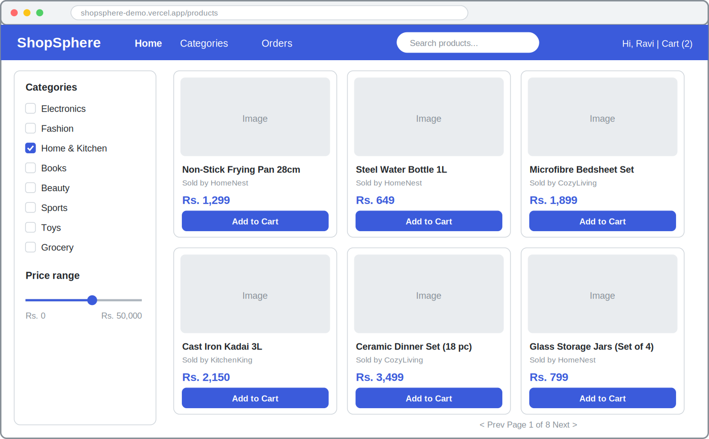
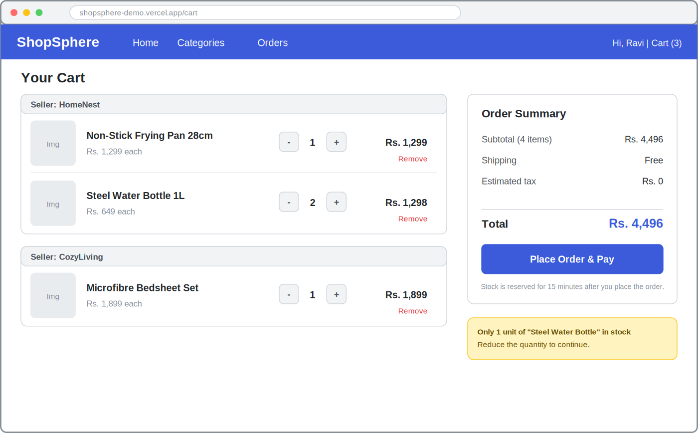
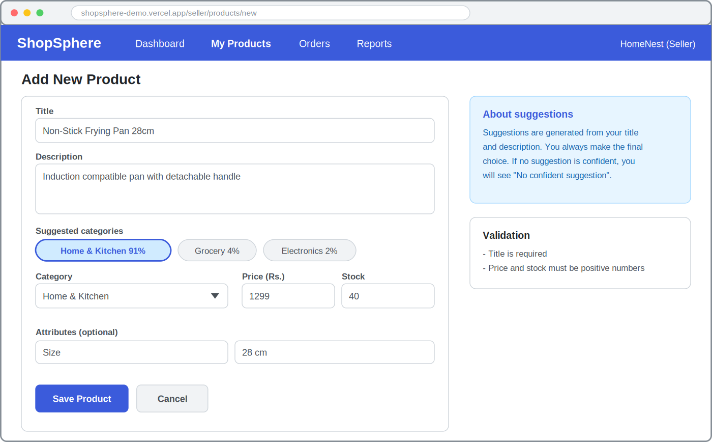
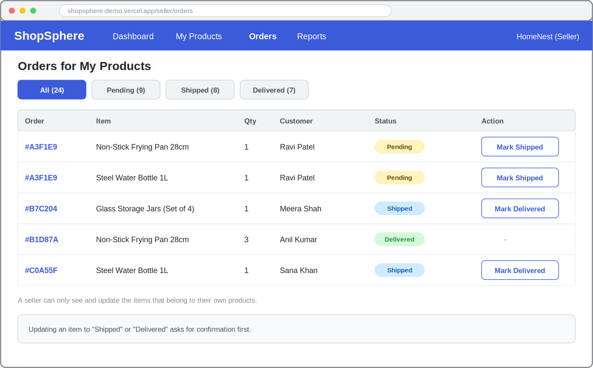
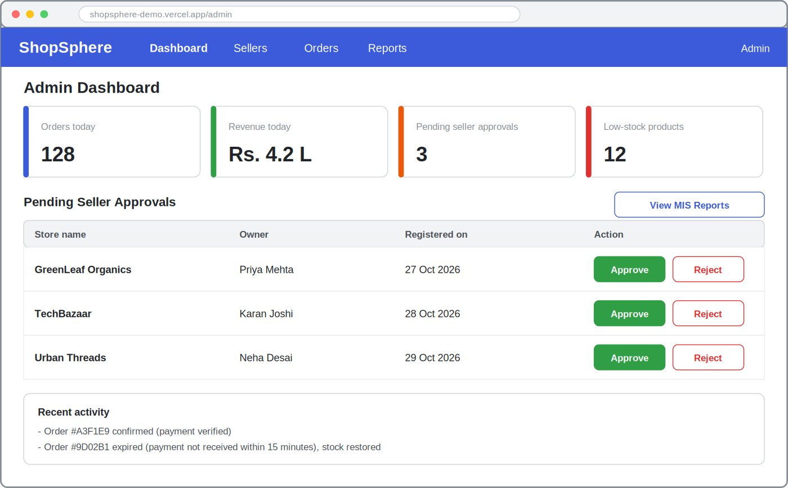

# 16. GUI Design (Mock Screens)

## 16.1 Design Approach

The mock screens below are low-detail wireframes of the main screens of each role. They show layout, content, and behaviour rather than final visual styling. The interface follows these principles:

- **Familiar patterns:** a top navigation bar, a product grid, and a cart with an order summary, as on most shopping sites.
- **One layout per role:** customers, sellers, and administrators each see only the menu items they are allowed to use.
- **Clear feedback:** every form shows validation errors next to the field, and risky actions ask for confirmation.
- **Designed states:** screens show how they look when data is missing, invalid, or unavailable, not only the "happy path".
- **Responsive:** the layouts reflow on smaller screens; the product grid shows fewer columns on a phone.

## 16.2 Screen Map

| # | Screen | Users |
|---|---|---|
| 16.3 | Login | All |
| 16.4 | Product listing | Guest, Customer |
| 16.5 | Cart and checkout | Customer |
| 16.6 | Add product | Seller |
| 16.7 | Seller orders | Seller |
| 16.8 | Admin dashboard | Admin |

## 16.3 Login

**Users:** All users

**Purpose:** Let a registered user log in; new users can register as a customer or as a seller.

**Main elements**

- Email and password fields
- Log In button
- Links to register as a customer or to sell on ShopSphere

**States and validation**

- An invalid email shows an inline message under the field
- A wrong password shows a general error and keeps the email filled in
- After login, customers go to the product listing, sellers to their dashboard, and administrators to the admin dashboard

**Related endpoints:** `POST /auth/login`, `POST /auth/register`

## 16.4 Product Listing

**Users:** Guest, Customer

**Purpose:** Let shoppers browse and filter products from all sellers.

**Main elements**

- Search box in the header
- Category checkboxes and a price range filter
- Product cards with image, title, seller name, price, and an Add to Cart button
- Pagination

**States and validation**

- Empty state: a friendly message and a Clear filters button when no product matches
- Loading state: grey placeholder cards while products load
- An out-of-stock product shows a disabled Add to Cart button labelled Out of stock

**Related endpoints:** `GET /products`, `POST /cart/items`

## 16.5 Cart and Checkout

**Users:** Customer

**Purpose:** Review items grouped by seller, adjust quantities, and place one order with one payment.

**Main elements**

- Cart items grouped by seller with quantity controls and a Remove link
- Order summary with subtotal, shipping, and total
- Place Order & Pay button
- Note that stock is reserved for 15 minutes after the order is placed

**States and validation**

- If a quantity exceeds the available stock, a warning explains how many units remain and checkout is blocked until it is fixed
- An empty cart shows a message and a link back to the listing
- After Place Order, the payment window of the gateway opens; the customer then sees a success or failure screen

**Related endpoints:** `GET /cart`, `DELETE /cart/items/:id`, `POST /orders`

## 16.6 Add Product

**Users:** Seller

**Purpose:** Let an approved seller create a listing, with help from the category suggestion feature.

**Main elements**

- Title, description, category, price, stock, and optional attributes
- Suggested categories shown as chips with confidence; selecting a chip fills the category field
- Save Product and Cancel buttons

**States and validation**

- Title is required; price and stock must be positive numbers
- If the model is not confident, the suggestion area says No confident suggestion and the seller chooses manually
- The seller can ignore the suggestions at any time

**Related endpoints:** `POST /products/suggest-category`, `POST /products`

## 16.7 Seller Orders

**Users:** Seller

**Purpose:** Show a seller the order items for their own products and let them update fulfilment.

**Main elements**

- Filter tabs for All, Pending, Shipped, and Delivered
- Table with order, item, quantity, customer, status badge, and action button
- Mark Shipped and Mark Delivered buttons

**States and validation**

- A seller sees only items that belong to their own products
- Changing a status asks for confirmation first
- A delivered item has no further action

**Related endpoints:** `GET /orders`, `PATCH /orders/:id/items/:itemId`

## 16.8 Admin Dashboard

**Users:** Admin

**Purpose:** Give the administrator an overview of the platform and a place to approve sellers.

**Main elements**

- Summary cards: orders today, revenue today, pending seller approvals, and low-stock products
- Table of pending sellers with Approve and Reject buttons
- Link to the MIS reports (section 17)
- Recent activity list

**States and validation**

- Empty state when no seller is pending
- Reject asks for confirmation
- Cards link to the corresponding detailed report

**Related endpoints:** `GET /admin/sellers/pending`, `PATCH /admin/sellers/:id/approve`, `GET /admin/reports/*`
